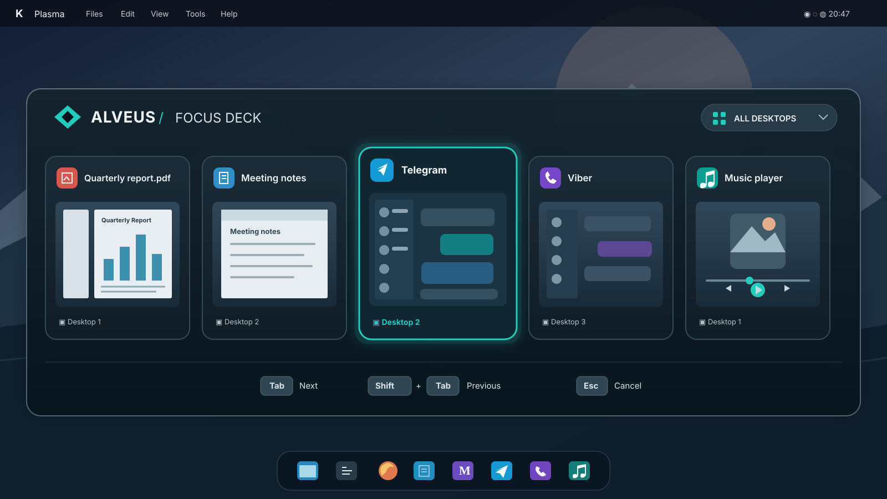

# Alveus Focus Deck


**A thumbnail-first KWin Alt+Tab switcher theme for KDE Plasma 6.**

Alveus Focus Deck gives the native KWin task switcher a calmer, more deliberate layout: one clearly emphasized active window, nearby previews, and an adaptive grid when the window list grows.

> **Project status:** experimental. Static checks are being automated, but live validation on a real KDE Plasma session is still required. This is not yet a stable release.

## Concept preview



*Illustrative concept mockup, not a screenshot captured from a running KWin session. The installed theme uses live KWin window thumbnails.*

## What it does

- **1–6 windows:** a horizontal Focus Deck with the selected window emphasized in the center.
- **7+ windows:** an adaptive thumbnail grid.
- **Native previews:** window thumbnails are rendered through KWin's `KWin.WindowThumbnail` component.
- **Useful labels:** application icon, window/document title, desktop label, and minimized state.
- **Keyboard-first:** KWin keeps control of Alt+Tab and reverse switching; the theme adds arrow-key navigation for the visible layout.
- **Mouse selection:** click a card to activate that window.
- **Quiet visual language:** graphite surfaces, restrained teal focus outline, compact labels, and short transitions.

PDF viewers, LibreOffice Writer/Calc/Impress, browsers, Telegram, Viber, Murglar, and other applications are treated equally. The theme does not inspect file types or classify applications.

## What it is not

Focus Deck is a **KWin WindowSwitcher package**, not a separate application.

- No dock, app launcher, pinned favourites, or application shortcuts.
- No custom app categories, search, filtering, or automation.
- No KWin script, background service, DBus integration, or external process.
- No virtual-desktop manager. KWin continues to own desktop navigation and window activation.
- No full desktop overview. A card can show the desktop name supplied by the KWin model; the available window list still follows the active Task Switcher configuration.

For quick access to Telegram, Viber, Murglar, or folders, use the normal KDE panel. Focus Deck is only for switching between windows that are already open.

## Requirements

- KDE Plasma 6 running the KWin window manager.
- KWin's QML switcher API, including `KWin.TabBoxSwitcher` and `KWin.WindowThumbnail`.
- `kpackagetool6` to install or remove the package.

This theme is KWin-specific. It is not a theme for Cinnamon, Xfce, GNOME Shell, or Windows.

## Install

Clone the repository and run the installer as your normal user:

```bash
git clone https://github.com/bezeza/Alveus-focus-deck.git
cd Alveus-focus-deck
bash ./install.sh
```

Then open:

**System Settings → Window Management → Task Switcher**

Select **Alveus Focus Deck** as the main task-switcher layout. The exact wording can vary slightly between Plasma releases.

The installer uses the user-level KPackage installation and does not edit KWin shortcuts or change your selected layout automatically.

### Update

Pull the latest changes and run the installer again:

```bash
git pull
bash ./install.sh
```

### Uninstall

First select another task-switcher layout in System Settings, then run:

```bash
bash ./uninstall.sh
```

## Controls

| Action | Control |
|---|---|
| Next window | Alt+Tab (native KWin action) |
| Previous window | Shift+Alt+Tab (native KWin action) |
| Move through horizontal deck | Left / Right |
| Move through grid | Arrow keys |
| Cancel switcher | Esc (native KWin action) |
| Activate a visible card | Mouse click |

KWin remains responsible for the actual window list, cycling order, and activation lifecycle.

## Performance approach

The package is designed to stay lightweight:

- the overlay is instantiated only while the switcher is visible;
- the theme uses KWin's native thumbnail component;
- the layout does not run polling loops or timers;
- there are no shader effects, backdrop-blur passes, background services, or external processes;
- the grid uses a zero-sized delegate cache buffer to avoid retaining an unnecessary off-screen card backlog.

These are design choices, not benchmark results. CPU/GPU usage, memory behavior, and responsiveness still need to be measured on a live Plasma desktop with realistic window counts.

## Known limitations

- Live Fedora KDE / Plasma 6.8.x validation has not yet been completed.
- The desktop label depends on the desktop-name role being provided by the KWin switcher model.
- Thumbnail rendering depends on KWin compositing and the running session.
- Very large window lists, multiple monitors, high-DPI scaling, minimized windows, and mixed desktop scopes need manual testing.
- This project changes only the visual switcher layout. It does not provide a full desktop or activity overview.

## Development

- [Roadmap](ROADMAP.md)
- [Changelog](CHANGELOG.md)
- [Design notes](docs/DESIGN.md)
- [Manual test plan](docs/TESTING.md)
- [Development log](docs/DEVELOPMENT_LOG.md)
- [Repository description and suggested GitHub topics](docs/REPOSITORY-METADATA.md)
- [Contributing](CONTRIBUTING.md)
- [Agent instructions](AGENTS.md)
- [License](LICENSE)

## References

- [KDE documentation: Create a custom Window Switcher](https://develop.kde.org/docs/plasma/windowswitcher/)
- [KWin built-in thumbnail grid source](https://github.com/KDE/kwin/tree/master/src/tabbox/switchers/thumbnail_grid)

## Keywords

KDE, KDE Plasma 6, KWin, KWin WindowSwitcher, Alt+Tab, task switcher, window switcher, QML, Linux desktop, desktop customization.
