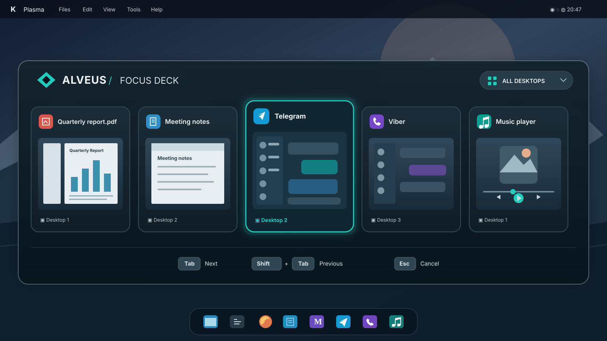

# Alveus Focus Deck

**Тема перемикача вікон Alt+Tab для KWin у KDE Plasma 6.**


Alveus Focus Deck змінює лише вигляд штатного перемикача KWin: активне вікно виділяється в центрі, поруч видно інші мініатюри, а для великої кількості вікон використовується сітка.

> **Статус:** експериментальна версія. Статичні перевірки автоматизовані, але перевірка в реальному сеансі KDE Plasma ще потрібна. Це поки не стабільний реліз.

## Концепт



*Ілюстративний макет, а не скриншот із запущеного KWin. У встановленій темі використовуються живі мініатюри вікон.*

## Можливості

- 1–6 вікон: горизонтальна композиція з активним вікном у центрі.
- 7 і більше: адаптивна сітка мініатюр.
- Нативні мініатюри KWin.
- Назва вікна/документа, іконка програми, назва робочого столу та позначка мінімізованого вікна.
- Перемикання клавішами та активація вікна кліком.
- Стриманий графітовий дизайн із бірюзовим акцентом.

PDF, LibreOffice, Telegram, Viber, Murglar та інші програми відображаються однаково. Тема не розпізнає типи програм і не створює категорій.

## Чого тема не робить

Це лише пакет **KWin WindowSwitcher**, а не окрема програма.

- Немає дока, запускатора, закріплених програм чи швидких ярликів.
- Немає пошуку, фільтрів, категорій або автоматизації.
- Немає фонового процесу чи KWin-скрипту.
- Немає керування віртуальними робочими столами.

Для швидкого запуску Telegram, Viber, Murglar або папок використовуй звичайну панель KDE.

## Вимоги

- KDE Plasma 6 із віконним менеджером KWin.
- QML API KWin: `KWin.TabBoxSwitcher` і `KWin.WindowThumbnail`.
- `kpackagetool6` для встановлення.

Не призначена для Cinnamon, Xfce, GNOME Shell або Windows.

## Встановлення

```bash
git clone https://github.com/bezeza/Alveus-focus-deck.git
cd Alveus-focus-deck
bash ./install.sh
```

Далі відкрий **System Settings → Window Management → Task Switcher** і вибери **Alveus Focus Deck**.

Інсталятор не змінює гарячі клавіші й не перемикає тему автоматично.

## Оновлення та видалення

Оновлення:

```bash
git pull
bash ./install.sh
```

Видалення: спочатку вибери іншу тему перемикача в налаштуваннях KDE, потім:

```bash
bash ./uninstall.sh
```

## Документація

- [Roadmap](ROADMAP.md)
- [Changelog](CHANGELOG.md)
- [Дизайн](docs/DESIGN.md)
- [План ручного тестування](docs/TESTING.md)
- [Журнал розробки](docs/DEVELOPMENT_LOG.md)
- [Contributing](CONTRIBUTING.md)
- [Ліцензія](LICENSE)
